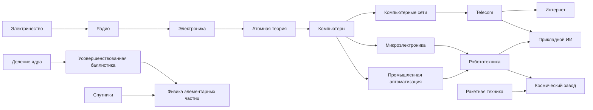

# Позднее дерево технологий — прототип v5

Цель прохода: дать вычислениям, связи, промышленности и космонавтике отдельные направления развития. Исправления реализованы в `mod/SQL/TechnologyRefinements.sql` и `mod/SQL/TechTreePresentation.sql` поверх вычислительной ветки v1–v3. Это стартовая схема для первой игровой пробы.

## Новые этапы

| Технология | Требования | Цена на стандартной скорости | Эффект |
| --- | --- | --- | --- |
| Компьютерные сети | Компьютеры | 7000 | +10% золота города с фондовой биржей; путь к телекоммуникациям и интернету |
| Микроэлектроника | Компьютеры | 7000 | +4 науки города с дата-центром; предпосылка робототехники |
| Промышленная автоматизация | Компьютеры | 7000 | +10% производства города с фабрикой; предпосылка робототехники |
| Прикладной ИИ | Телекоммуникации + робототехника | 9500 | Дополнительные +15% науки при дата-центре, +10% производства при фабрике, +3 науки при лаборатории |

Микроэлектроника означает массовые интегральные схемы и миниатюризацию после первых электронных компьютеров. Автоматизация означает распространение компьютерного управления промышленными процессами; ранние механические автоматы не требуют изучения этой технологии. Прикладной ИИ означает массовое применение современных методов, а не возникновение дисциплины.

## Исправления существующих связей

| Объект | До переработки | В v5 | Причина |
| --- | --- | --- | --- |
| Электроника | Replaceable Parts + Flight в справочнике BNW | Исходные требования плюс радио (электричество является предком радио) | Электротехническая основа должна быть обязательной |
| Компьютеры | Radar + Combined Arms в исходной BNW; Electronics + Radar в v3 | Атомная теория, которая уже требует электронику и пластмассы | Радар и военная доктрина не являются обязательными предшественниками вычислительной техники |
| Телекоммуникации | Экология | Компьютерные сети; радио остаётся предком через вычислительную ветку | Современная связь опирается на передачу сигналов и сетевую инфраструктуру |
| Интернет | Телекоммуникации; в v3 также прямая связь с сетями | Телекоммуникации, которые уже требуют сети | Компьютеры обязательны через сетевую ветку; лишняя прямая линия удалена |
| Робототехника | Компьютеры + ракетная техника | Микроэлектроника + промышленная автоматизация | Промышленные роботы не требуют разработки ракет |
| Космический завод | Робототехника | Робототехника и дополнительная ракетная техника | Космическое применение сохраняет ракетные знания |
| Ракетный крейсер | Робототехника | Робототехника и дополнительная ракетная техника | Военное применение сохраняет ракетные знания |
| Атомная подлодка | Телекоммуникации | Телекоммуникации и дополнительное деление ядра | Требование реакторной технологии соответствует урану в ресурсной схеме |
| Физика элементарных частиц / `TECH_PARTICLE_PHYSICS` | Телекоммуникации + усовершенствованная баллистика + мобильная тактика | Усовершенствованная баллистика + спутники; название сохранено | Ядерная наука и космическое применение вместо обязательной военной тактики |

У физики элементарных частиц по прямому указанию пользователя сохранены исходные название, описание, цитата, озвучивание, `Type`, стоимость, эпоха, позиция и открытие двигателя корабля. Меняются только зависимости. Связь со спутниками отражает космическое применение позднего игрового узла, а не дату возникновения научной дисциплины. Другие технологии сохраняют внутренние идентификаторы. Дополнительные требования зданий и юнитов задаются штатными `Building_TechAndPrereqs` и `Unit_TechTypes`.

Общий срок научной победы всё ещё нужно измерить. Новые этапы микроэлектроники и автоматизации лежат на пути к робототехнике; одновременно вычислительная ветка ускоряет науку. Отдельного множителя замедления, новых космических деталей или увеличения их цены нет.

## Схема основных ветвей

На схеме показана изменённая часть дерева; исходные предшественники электроники и пути к спутникам опущены. Это схема зависимости исследований и отдельных открытий, а не точная раскладка интерфейса.

## Суммарные эффекты

- Дата-центр: исходные +25% науки; после микроэлектроники дополнительно +4 науки; после ИИ вклад процентных бонусов дата-центра составляет +40%.
- Фабричный город: автоматизация даёт +10% производства, ИИ — ещё +10%. Совокупный дополнительный вклад этих исследований +20%; обычный эффект самой фабрики сохраняется отдельно.
- Наука университета/лаборатории после компьютеров и бонус лаборатории после ИИ сохраняются из v3.
- Сети дают экономический путь; они не дублируют процентный научный эффект дата-центра.

Раскладка v5: сети `(15, 7)`, микроэлектроника `(15, 8)`, автоматизация `(15, 9)`, телекоммуникации `(16, 3)`, робототехника `(16, 6)`, ИИ `(17, 3)`, технология будущего `(18, 4)`. Интернет и ИИ — параллельные применения телекоммуникаций, оба ведут к технологии будущего. Лазеры требуют микроэлектронику вместо прямой связи с компьютерами.

У v4 связь компьютеров `(14, 7)` с сетями `(15, 2)` имела вертикальный размах 5 строк, тогда как штатный код рисует вертикальные соединения только для 1–4. Длинные горизонтальные линии также проходили через карточки, а исходящие разветвления смешивали разные длины. Старый тестовый фрагмент использовал неточные координаты и этого не выявлял; v5 воспроизводит прежнюю ошибку и проверяет исправленные ограничения. Семантически избыточные дальние связи заменены на цепочки через существующих предков: радио → электроника → атомная теория → компьютеры; деление ядра → баллистика → физика элементарных частиц.

Для четырёх новых технологий использован штатный `ScenarioTechButton` 1–4: общий стандартный значок способности с точной подсказкой соответствующей технологии. Четыре неиспользуемых в обычной партии сценарных текста заменены русскими/английскими описаниями бонусов. Флаги отвечают только за интерфейс; фактические бонусы по-прежнему применяет Lua. Полная замена TechTree.lua, фиктивные игровые эффекты и зависимость от EUI не нужны. У компьютеров уже есть значок открываемого дата-центра.

Здания-носители бонусов расширены с шести до восьми; применяются прежние правила сохранения, командных технологий и смены владельца.

## Проверки и продолжение

Проверяются сохранение всех исходных технологий, отсутствие циклов/совпадений позиций, ограничения штатных соединений на проверенных координатах позднего фрагмента, отдельные ракетные и ядерные требования, русские/английские тексты и жизненный цикл двух новых городских бонусов. Полная база BNW и игровой интерфейс в среде разработки недоступны: линии дерева, рекомендации ИИ и темп оцениваются в первой партии.

Следующими направлениями после этой пробы могут стать биотехнологии и энергетика. Лаборатория пока сохраняет исходное открытие пластмассами: перенос главного научного здания одновременно с новой вычислительной веткой существенно изменил бы сразу несколько путей развития.

Справочные исходные связи: [электроника](https://civilization.fandom.com/wiki/Electronics_%28Civ5%29), [телекоммуникации](https://civilization.fandom.com/wiki/Telecommunications_%28Civ5%29), [робототехника](https://civilization.fandom.com/wiki/Robotics_%28Civ5%29), [физика элементарных частиц](https://civilization.fandom.com/wiki/Particle_Physics_%28Civ5%29). Реализация дополнительных требований изучена по [исходникам BNW — CvUnitClasses.cpp](https://github.com/Gedemon/Civ5-DLL/blob/master/CvGameCoreDLL_Expansion2/CvUnitClasses.cpp).

Источник координат для регрессионной проверки: [BNW Technologies data](https://civilization.fandom.com/wiki/Module:Data/Civ5/BNW/Technologies). Ограничения соединений и штатные сценарные маркеры сверены с [TechTree.lua](https://github.com/catscatsforever/Civ5-Patch/blob/main/tmp/ui/TechTree.lua) и [TechButtonInclude.lua](https://github.com/catscatsforever/Civ5-Patch/blob/main/tmp/ui/TechButtonInclude.lua); это модифицированное зеркало UI, его код в пакет не копируется.

## Дополнение v6 — механизация сельского хозяйства

Индустриальная технология «Механизация сельского хозяйства», 2350 науки на стандартной скорости, требует удобрения и паровой двигатель. Даёт каждой ферме max(0, собственные соседние неразграбленные фермы − 1) пищи. Обычные бонусы сохраняются; раннего соседства и городского предела нет. Это самостоятельное ответвление без обязательных потомков.

Чтобы добавить индустриальную колонку, v6 сдвигает все GridX≥11 поверх v5 на +1. Механизация занимает (11,9), железная дорога — (12,4). Сети, микроэлектроника, автоматизация теперь (16,7/8/9), робототехника (17,6), ИИ (18,3), технология будущего (19,4). Полосы эпох не перекрываются. Удобрения больше не являются предпосылкой динамита: военная наука сохраняет химию среди его предков. Это отделяет аграрное развитие от пути к артиллерии и сохраняет читаемые соединения новой ветки.

Проверка адаптеров уточнена по коду штатного renderer: у смешанного соединения парового двигателя длинные верхние ветви и короткая нижняя допустимы. Проверяются конкретные позиции углов, горизонтальные проходы, предел четырёх строк и новые полосы эпох. Кнопка способности механизации использует штатный слот 1 совместно с сетями; подсказка содержит два явно названных эффекта. Интерфейс дерева не заменён. Все изменения пока проверены вне игры.
